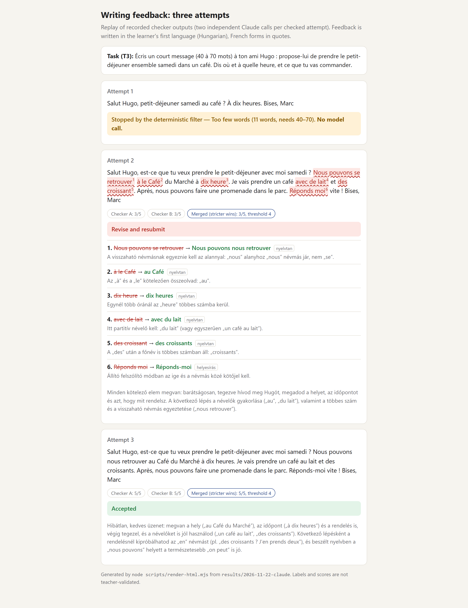
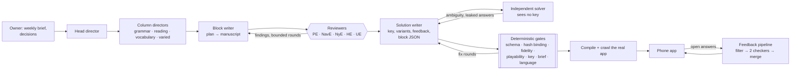

# Plusdeça — an LLM course-production pipeline with deterministic gates

**Question:** how can LLMs write and check a language course, and give feedback on a learner's answers, so that every
output is *reviewed*, *bound to what was reviewed* and *measurable*, instead of trusted?

Plusdeça is a private, actively developed French course (B1 → C1) with an offline phone app that I build for one adult
learner (Hungarian L1). This repository publishes its AI part:

| Part | What it is | Runs here offline |
|---|---|---|
| [**Authoring chain**](pipeline/) | An orchestrator ("CEO") that drives 17 LLM roles as separate headless sessions: directors, block writers, a solution writer, five kinds of reviewer and an independent solver without the key. Bounded revision rounds, forced rewrites, escalation to the human owner. | 119 orchestrator tests with a fake model CLI |
| [**Deterministic gates**](pipeline/p5/) | Every block an LLM produces must pass schema, review-binding hashes, fidelity to the reviewed manuscript, playability, answer-key and brief checks before it is compiled into the app. | 69 gate tests + 4 on the real example |
| [**A real unit, end to end**](pipeline/examples/w01-u-2-1/) | Every reviewer report and author output of one week-1 unit (122 model calls in two runs), the reviewed manuscript and the block that ships in the app. | gates re-run on it |
| [**Feedback on learner writing**](feedback-eval/) | A filter, two independent LLM checkers with schema-bound output, a strict merge and a revision loop, with a labelled eval set and a recorded live run. | 12 tests, replay of 56 recorded calls |
| [**Production statistics**](docs/week1-run-stats.md) | Counts from the 40 real runs that produced week 1: 2,163 model calls, 118 h of model time, 1,275 review steps. | — |



## The idea in one diagram



Three rules hold everywhere:

1. **No role approves its own work.** Writers, reviewers and the solver are separate sessions with separate role cards
   and no shared conversation. The solver gets only the learner's worksheet: no key and no author notes.
2. **LLM output is a proposal; code decides.** Reviewers return a machine-readable verdict that the orchestrator parses.
   The gates are plain code. A block reaches the app only if its content hash matches the manuscript the reviewers passed.
3. **Every loop is bounded.** Revision rounds have a cap (4 for the professional reviewer, 2 for the others, 3 for gate
   fixes); a major finding still open after round 2 forces a full rewrite instead of another patch;
   a block that still fails stops as `BLOCKED_*` and waits for a human decision instead of looping.

More: [architecture](docs/architecture.md) · [the 17 roles](docs/agents.md) · [U21 walkthrough](pipeline/examples/w01-u-2-1/).

## Run it (offline, no account, no API key)

Requires Node.js ≥ 22.

```bash
npm install --prefix pipeline/editorial/p4-planning/ceo   # one small dev dependency (smol-toml)
npm test                                                   # all suites below
npm run test:pipeline    # orchestrator (fake model CLI) + gates + the real example
npm run test:feedback    # feedback pipeline (replay)
npm run demo             # feedback walkthrough in the terminal (REPLAY of recorded outputs)
node pipeline/p5/gates.mjs pipeline/examples/w01-u-2-1/2-french-life-round/output/block.w01-u-2-1.json \
     --handoffs pipeline/examples/w01-u-2-1/2-french-life-round/output     # GATE_PASS
```

The orchestrator can run for real (`node ceo.mjs run …`), but that needs logged-in Codex/Claude CLIs and the private
course references; the tests replace the model with a scripted fake CLI.

## What the numbers say, and what they do not

- **Week 1 (23 blocks) was produced by this chain and runs in the app.** It took 40 runs: 33 completed; 5 stopped at the
  gates and 2 for other reasons (missing evidence, a step error), and those units were finished afterwards. Reviewers asked for a revision in
  37% of 1,275 review steps. The independent solver ran 172 times.
- **The gates catch what the LLM steps miss.** In the U21 example, after all reviewers had passed the manuscript and
  the solution, the gates found 2 schema errors, then 74 places where the block JSON did not match the reviewed text,
  then one app-contract error; the solution writer fixed them in three rounds.
  When a stricter language rule (CL-27) was added two weeks later, the gates failed the already-released U21 with 95
  errors, and a targeted round fixed it. A test in this repository re-runs both versions.
- **The feedback checkers are at ceiling on a constructed set** (25/25, 21/21 injected errors found). This shows
  consistent rubric application, not accuracy on real learner writing; see [feedback-eval](feedback-eval/#how-to-read-these-numbers).
- **Not shown:** learning outcomes (no learner study), content quality beyond what the reviewers and gates check,
  weeks 2–40 (the 40-week plan is a plan), cost per block in money (runs used flat-rate subscriptions).
  A domain expert reviews selected parts of the course; there is no systematic teacher rating yet.

## What is not in this repository

The course content (except the one unit above), the source and media libraries, third-party texts and audio, the app,
the release tooling, and the private integrations of the orchestrator (e-mail notifications, a GitHub relay and a
dashboard) stay private. The orchestrator, prompts and gates here are copied from the private repository with those
integrations removed; [pipeline/README.md](pipeline/README.md#differences-from-the-private-version) lists every change.
The prompts and role cards are in Hungarian, as they run; [docs/agents.md](docs/agents.md) describes each role in English.

## Repository layout

| Path | Contents |
|---|---|
| `pipeline/editorial/p4-planning/ceo/` | Orchestrator: `ceo.mjs`, `lib/` (engine, weekly chain, revision mode, verdict parsing, gate hook), `agents-src/` (role cards), `assignments/` (prompt templates), tests |
| `pipeline/.codex/agents/`, `pipeline/.claude/agents/` | Role cards compiled for the Codex and Claude CLIs (`node build-agents.mjs`) |
| `pipeline/p5/` | Block schema, gates, compiler to the app's course contract, tests |
| `pipeline/examples/w01-u-2-1/` | The real unit: two runs, every step output, reports, final block |
| `pipeline/scripts/run-stats.mjs` | Aggregates the private run reports into `docs/week1-run-stats.*` |
| `feedback-eval/` | Feedback pipeline, eval set, recorded run, teacher-rating packet |
| `docs/` | Architecture, roles, run statistics |

The private repository's folder layout is kept under `pipeline/` so that the code's relative paths still work.

## Author

Áron Bán-Szabó. The system design, course design, role definitions and evaluation design are mine. Much of the code
and all course drafts were written with AI assistants (Claude Code, Codex) under my specification and review, which
is the subject of this repository. MIT licence for the code; the U21 course unit is published as an example only.
