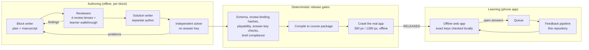
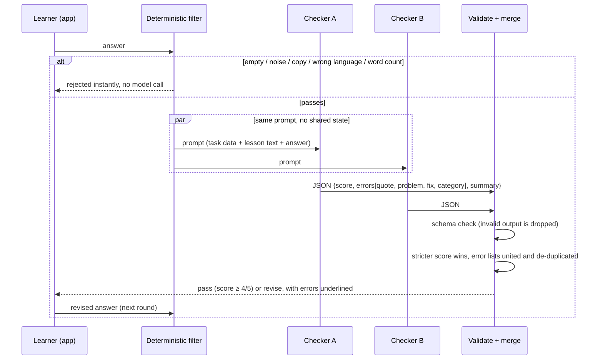

# Architecture

This page places the extracted component (writing feedback) inside the larger private system it comes from.
Only the feedback component is runnable from this repository. Everything else is described here and not shipped.

## 1. The whole system (private, single learner)

Plusdeça is a self-built French course (B1 → C1) for one adult learner, with an offline-first phone web app.
LLMs are used in two different places:

1. **Authoring:** an orchestrated chain of LLM roles writes and reviews the course content.
2. **Learning:** LLM checkers give feedback on the learner's open answers.

Both places follow the same rule: *an LLM output is a proposal; deterministic checks and independent reviewers decide whether it is used.*

| Part | What it does | Evidence it works | Not shown by that evidence |
|---|---|---|---|
| Authoring chain | Headless role sessions (`codex exec`, `claude -p`). Each role gets a fresh session. Bounded fix rounds. A block is complete only when the independent solver reports no problems. | The first week (23 blocks) went through it and runs in the app. | Content quality beyond what the reviewers and the solver check. Weeks 2–40 are planned, not produced. |
| Release gates | Deterministic checks on every block: content hashes bind the release to the reviewed manuscript, then playability, answer-key and brief checks. Then compilation and a crawl of the real app. | Unit tests, plus a crawl report for each release. | Pedagogical value. |
| Phone app | Offline PWA. Closed answers are checked locally against keys, open answers are queued for feedback. | In use by the learner on a phone. A domain expert reviews selected parts. | Learning outcomes (no study). |
| Feedback pipeline | See below. | `results/` in this repository. | See [Limitations](../README.md#limitations). |

## 2. The feedback pipeline (this repository)

Design decisions, with the reason for each:

- **Filter before the model.** Junk answers cost nothing and get an instant reason. The filter has no
  false-positive budget: an answer that matches the reference is never filtered.
- **The model scores, code decides.** The model returns a 0–5 score. The pass threshold (≥ 4) is applied in code,
  so the policy cannot drift with the prompt.
- **Two independent checkers, stricter wins.** In production these are two different vendors (Claude and Codex),
  both run from flat-rate subscriptions on the learner's machine. If one fails, the other decides alone and the result is
  flagged `single`. If both fail, the answer stays *pending*: there is never a silent pass.
- **Untrusted output.** Model output is validated against the schema like any other input. Error quotes are used to
  underline the learner's text only where they occur verbatim.
- **Learner text is data.** The answer is fenced in delimiters, and the rules say it is not an instruction.
  The eval set contains one injection attempt.
- **Privacy.** Only task data and the answer go to the checker. No name, e-mail or account id is sent.
- **Feedback in L1.** Explanations are in Hungarian (the learner's first language). French forms are quoted.

What this repository changes for the portfolio: both checker slots are filled by two independent Claude calls
(the Codex slot was out of scope). The queue, the Cloudflare Worker and the app UI are not included.
The pipeline logic itself (`vendor/`) is the production code, byte-for-byte.
